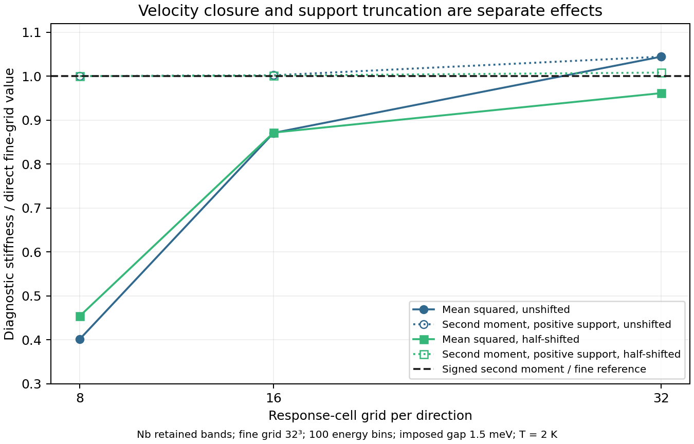

# Response-cell refinement separates two numerical effects

All values below use retained Nb bands, a native 32³ fine grid, 100 energy bins,
an imposed constant gap 1.5 meV, and matched energy quadrature. These are
numerical diagnostics, not converged penetration depths or experimental fits.

## Completed controls

| Response grid | Squared mean / fine reference, unshifted | Squared mean / fine reference, half-shifted | Runtime | Peak RSS |
|---|---:|---:|---:|---:|
| 8³ | 0.402 | 0.455 | 52.6 s | 178 MB |
| 16³ | 0.871 | 0.872 | 50.8 s | 286 MB |
| 32³ | 1.044 | 0.961 | 52.8 s | 1266 MB |

Ratios are at 2 K. Other temperatures, exact values and hashes are in
nb_moment_refinement_summary.json and the three source results JSONs.
Resources are measured individual-process peaks, not forecasts or allocated
memory. See nb_moment_refinement_resources.json for receipt/executable hashes.
All runs passed the same 120-second/3-GiB guard. Native reconstruction control
errors are exactly zero for DOS, first velocity moment and curvature moment.

The all-support signed second-moment sums match the direct fine-grid reference
at all three response grids. Across 2/4/8 K the largest absolute difference is
1.24e-15. This verifies moment conservation at the chosen quadrature, not the
continuum band/energy limit.

## Interpretation

Two approximations are distinguishable. Squaring the mean velocity loses a
large response contribution on coarse cells; refinement reduces that closure
effect. Separately, the native positive-DOS support selection discards signed
optimized-tetrahedron contributions. At 32³ the unshifted first and second
active-support moments coincide, while both exceed the all-support reference
by about 4.4%. This isolates support truncation from velocity closure there.
The half-shifted interpolation still mixes neighboring fine-grid velocities.

Retaining a second moment avoids increasing the response-cell dimension merely
to recover this fixed-gap fine-grid sum. It does not permit refining the
interacting gap or phonon grid without corresponding inputs. The experiment
therefore supports a focused response-postprocessing method, not a complete
low-cost superconducting-material prediction pipeline.

## Current-source check

The current-geometry compatibility run also PASSed: 49.537 s, 206405632-byte
peak RSS. Extracted current compute_dosk/symm_dosk routines reproduce the
moment arrays with zero control error. At 8³ its complete diagnostic output
is byte-identical to the historical result for this fully shifted Nb case.
The current shifted-grid changes therefore do not remove the measured closure
effect here. See nb_velocity_moment_current_results.json and the explicit
compatibility boundary in current_moment_geometry.py. This is not a full
current QE/SCTK installation or a test of partially shifted/noncubic grids.

## Reproduction and remaining gates

```
python3 research/moment_refinement.py
.venv/bin/python research/moment_refinement.py --plot
```

The first command uses committed result JSONs and only the standard library.
The second requires matplotlib and regenerates the PNG/PDF figure. The native
producer and retained-input build instructions are in VELOCITY_MOMENT_METHOD.md.



Next: a held-out physical direction/cubic-symmetry control, unshifted-band
limit and energy refinement. A compatible converged gap, current normalization
and physical response approximation are still required before interpreting
penetration depths. PHYSICAL_INTERPRETATION_GATE.md explains why improved
quadrature alone cannot establish closer agreement with experiment.
